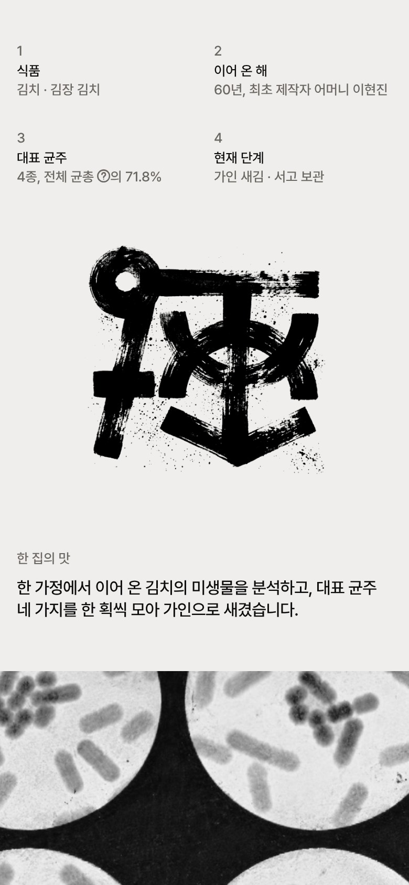

# 손맛 Sonmat

한 집안의 손맛을 미생물 단위로 기록하고, 그 결과를 가인(家印)이라는 문양으로 새기는 발효 아카이브 브랜드의 웹 시제품입니다.

| 손맛 웹사이트 | 손맛 균주 기록 (모바일) |
|---|---|
| [](https://yerin55746302.github.io/sonmat/sonmat/) | [](https://yerin55746302.github.io/sonmat/sonmat-record/) |
| 접수실 · 서고(3D) · 테스트 · 원리 · 소개 | QR로 여는 균주 기록 SM-26-1114-001 |

- 손맛 웹사이트: https://yerin55746302.github.io/sonmat/sonmat/
- 손맛 균주 기록: https://yerin55746302.github.io/sonmat/sonmat-record/

## 구성

```
index.html          두 페이지로 가는 첫 화면
sonmat/             손맛 웹사이트 (three.js 0.150.1, jsDelivr에서 불러옴)
sonmat-record/      손맛 균주 기록 모바일 페이지
docs/               README용 화면 이미지
```

글꼴: Pretendard (SIL Open Font License 1.1)
